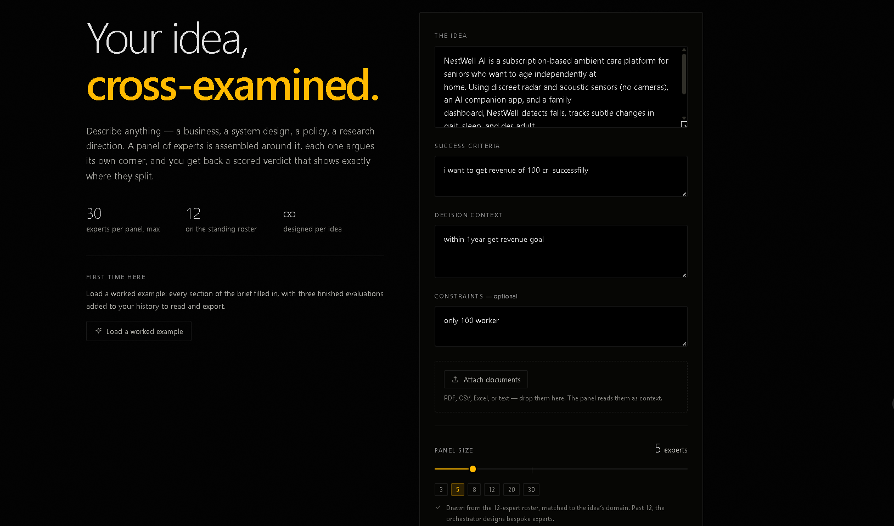
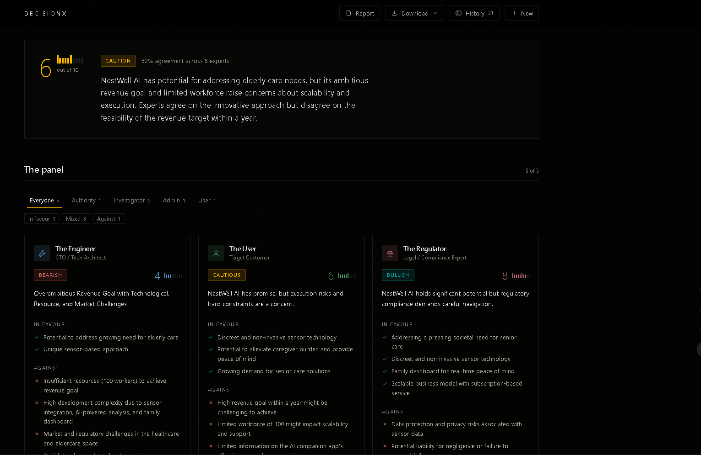

# DecisionX

DecisionX is a generalized, multi-agent idea evaluation platform designed to simulate a structured expert boardroom for evaluating business, technical, research, product, and creative ideas.

Instead of relying on a single AI response, DecisionX assembles multiple specialized AI experts, gives each expert an independent perspective, and then uses a dedicated synthesis agent to combine their opinions into a final decision-oriented report.

The goal is simple:

> **Don't just ask AI whether an idea is good. Ask multiple experts why it might succeed, why it might fail, and what you should do next.**


*Main Screen UI - Dashboard*


*Result Page - Boardroom Verdict and individual expert cards*

---

## 🎯 Why DecisionX?

Traditional AI chat interfaces generally provide a single perspective. While this can be useful for brainstorming, important decisions often require multiple viewpoints.

For example, a startup idea might look attractive from an investor's perspective but have serious technical limitations. Similarly, a technically impressive product might have weak market demand.

DecisionX addresses this problem by creating a virtual panel containing different expert perspectives.

A typical evaluation can involve:

* 💰 Investor — examines financial potential and investment attractiveness
* 🏗️ Engineer — evaluates technical feasibility
* 📊 Market Analyst — examines market size and competition
* 🎯 Product Strategist — evaluates product-market fit
* ⚠️ Risk Analyst — identifies potential failure points
* 🧠 Critical Thinker — challenges assumptions
* 📈 Growth Strategist — evaluates scalability and growth
* ⚖️ Ethics Advisor — identifies ethical and social concerns

The final decision is not based on one agent's opinion. Instead, DecisionX looks for **patterns, disagreements, risks, and opportunities across the entire panel**.

---

# ✨ Features

### 🤖 Dynamic Persona Assembly

DecisionX can work with a predefined set of expert personas or dynamically create new experts specifically for the submitted idea.

The platform currently supports **12 built-in expert roles**, while the Panel Architect can generate bespoke personas when the problem requires expertise outside the standard panel.

For example, submitting a:

> "Drone-based agricultural monitoring platform"

could result in a panel containing:

* Agricultural Technology Expert
* Drone Systems Engineer
* Investor
* Rural Market Specialist
* Computer Vision Engineer
* Regulatory Analyst
* Sustainability Expert
* Critical Reviewer

This makes the evaluation system adaptable rather than limited to a fixed group of reviewers.

---

### ⚡ Parallel Multi-Agent Execution

Experts evaluate the idea independently and in parallel.

This provides two major advantages:

1. **Reduced evaluation time**
2. **Greater diversity of opinions**

Each expert produces a structured response containing information such as:

* Overall verdict
* Confidence level
* Score
* Strengths
* Weaknesses
* Opportunities
* Threats
* Key assumptions
* Major risks
* Recommendations

The structured output also makes the results easier for the frontend to visualize.

---

### 🏛️ Boardroom Synthesis

After the individual experts finish their evaluations, DecisionX sends their findings to a dedicated synthesis agent.

The synthesizer acts like the chairperson of a boardroom.

It identifies:

* Areas of consensus
* Major disagreements
* Recurring risks
* Strongest opportunities
* Contradictory opinions
* Critical assumptions
* Most important next steps

The final output provides a higher-level perspective instead of simply displaying a collection of unrelated AI responses.

---

### 📊 Decision-Oriented Scoring

DecisionX converts qualitative expert opinions into structured scores.

The result page can present:

* Overall boardroom score
* Individual expert scores
* Confidence indicators
* Strength/risk comparisons
* SWOT analysis
* Consensus information
* Recommended actions

This makes it easier to compare multiple ideas using a consistent evaluation framework.

---

### 🌊 NDJSON Streaming

DecisionX uses NDJSON-based streaming to provide incremental results to the frontend.

Instead of waiting for every agent to finish before displaying anything, completed evaluations can appear progressively.

Event order: `attachments` (if files were uploaded) → `stage: reading` and a second `attachments` (only when long documents are being condensed) → `stage: assembling` → `panel` → one `persona` per expert → `stage: synthesizing` → `done` (or `error`).

This creates a more interactive experience where users can watch the virtual boardroom work in real time.

---

### 📚 Local Evaluation History

Previous evaluations are stored locally in the browser.

Users can:

* Reopen previous evaluations
* Compare previous decisions
* Add reviewer notes
* Keep track of ideas
* Export evaluation results

This allows DecisionX to function not only as an evaluation tool but also as a lightweight **personal decision archive**.

---

### 📤 Export Results

Evaluations can be exported for further analysis or sharing.

Supported formats include:

* HTML reports
* CSV data

The exported information can be used for:

* Presentations
* Business planning
* Research
* Documentation
* Internal decision-making
* Comparing multiple ideas

---

# 🧠 How DecisionX Works

The evaluation pipeline can be summarized as:

```text
User Idea
    │
    ▼
Idea Classification
    │
    ▼
Panel Architect
    │
    ├── Built-in Experts
    │
    └── Custom Experts
    │
    ▼
Parallel Expert Evaluation
    │
    ├── Investor
    ├── Engineer
    ├── Critic
    ├── Market Analyst
    ├── Strategist
    └── ...
    │
    ▼
Structured JSON Results
    │
    ▼
Boardroom Synthesizer
    │
    ▼
Consensus + Disagreement Analysis
    │
    ▼
Final Verdict
    │
    ├── Score
    ├── SWOT
    ├── Key Risks
    ├── Opportunities
    └── Action Plan
```

This architecture separates **individual reasoning** from **final synthesis**, reducing the risk of relying on a single AI perspective.

---

# 🔄 Evaluation Workflow

### Step 1 — Submit an Idea

The user provides a description of the idea along with optional:

* Success criteria
* Constraints
* Target audience
* Business context
* Technical requirements
* Additional background information

---

### Step 2 — Classify the Problem

The system analyzes the submitted brief and determines what type of expertise is required.

Possible categories include:

* Business
* Technology
* Product
* Finance
* Research
* Creative
* Social impact
* Strategy

---

### Step 3 — Assemble the Panel

DecisionX selects appropriate experts from the available personas.

If the standard personas are insufficient, the Panel Architect creates custom expert roles.

This allows the panel to adapt to unusual or highly specialized ideas.

---

### Step 4 — Run Expert Evaluations

Each expert independently evaluates the idea.

Experts are instructed to focus on their specific area of expertise rather than attempting to provide a generic response.

The results are returned using structured JSON, allowing the application to process them consistently.

---

### Step 5 — Synthesize the Opinions

The Boardroom Synthesizer receives the individual evaluations.

It analyzes the complete panel and determines:

**Where do experts agree?**

**Where do they disagree?**

**Which risks appear repeatedly?**

**Which assumptions are questionable?**

**What opportunities appear strongest?**

**What should the user do next?**

---

### Step 6 — Generate the Decision

The final result contains a consolidated boardroom verdict.

Instead of simply answering:

> "Yes, this is a good idea."

DecisionX attempts to answer:

> **"Is this idea worth pursuing, what could prevent it from succeeding, and what should you test next?"**

---

# 👥 Expert Persona System

DecisionX uses specialized personas to create diversity in the evaluation process.

Each persona has its own:

* Role
* Objective
* Evaluation criteria
* Perspective
* Risk tolerance
* Domain focus

This prevents every agent from approaching the idea in exactly the same way.

### Built-in Personas

The platform includes 12 predefined expert types covering areas such as:

* Investment
* Engineering
* Product
* Market analysis
* Strategy
* Risk
* Criticism
* Growth
* Ethics
* Operations
* Finance
* User perspective

The system can also generate additional personas dynamically when required.

---

# 🏗️ Architecture

DecisionX follows a decoupled frontend-backend architecture.

### Frontend

The frontend is responsible for:

* User input
* Panel configuration
* File uploads
* Real-time streaming
* Expert cards
* Charts
* Boardroom results
* Evaluation history
* Export functionality

Built using:

* Next.js
* React
* Tailwind CSS
* DaisyUI
* Framer Motion
* Recharts

---

### Backend

The backend handles:

* Request processing
* Idea classification
* Persona generation
* LLM communication
* Parallel execution
* JSON validation
* Result aggregation
* Boardroom synthesis
* Streaming responses

Built using:

* Python
* FastAPI
* Uvicorn

---

# 🔌 LLM Provider Architecture

DecisionX supports multiple LLM providers through a provider chain.

Current providers include:

* **Groq**
* **NVIDIA**
* **OpenRouter**

Groq is used as the primary provider because of its low-latency inference capabilities.

If a provider is unavailable or its API key is not configured, the system can fall back to another configured provider.

Conceptually:

```text
Request
   │
   ▼
Groq
   │
   ├── Available → Continue
   │
   └── Unavailable
          │
          ▼
       NVIDIA
          │
          └── Fallback
                 │
                 ▼
             OpenRouter
```

This improves reliability and reduces dependence on a single provider.

---

# 📁 Project Structure

A simplified project structure looks like:

```text
DecisionX/
│
├── frontend/
│   ├── app/
│   ├── components/
│   ├── public/
│   └── ...
│
├── backend/
│   ├── agents/          # personas, orchestrator, synthesizer, LLM client, context budget
│   ├── parsers/         # upload extraction (isolated parse worker)
│   ├── tests/           # pytest suite (LLM stubbed); tests/integration/ = live calls
│   ├── main.py          # FastAPI app, request guard, endpoints
│   ├── config.py        # every DECISIONX_* setting
│   ├── .env.example
│   ├── groqapi
│   ├── nvidiaapi
│   ├── openrouterapi
│   └── ...
│
├── images/
│   ├── Dashboard_image.png
│   └── Result_page.png
│
├── start_dev.bat
├── start_dev.sh
└── README.md
```

The exact structure may evolve as the project develops.

---

# 🛠 Tech Stack

| Layer         | Technology               |
| ------------- | ------------------------ |
| Frontend      | Next.js 16.3.0           |
| UI            | React 19                 |
| Styling       | Tailwind CSS v4          |
| Components    | DaisyUI                  |
| Animation     | Framer Motion            |
| Charts        | Recharts                 |
| Backend       | FastAPI                  |
| Server        | Uvicorn                  |
| Language      | Python                   |
| LLM Providers | Groq, NVIDIA, OpenRouter |
| Data Format   | JSON / NDJSON            |
| Storage       | Browser Local Storage    |

---

# 💡 Example Use Cases

DecisionX is designed to be domain-agnostic.

### 🚀 Startup Validation

Evaluate:

> "A subscription platform that provides AI tutors for engineering students."

The panel could investigate:

* Market demand
* Competition
* Pricing
* Technical feasibility
* Customer acquisition
* Investment potential
* Scalability

---

### 💻 Technical Projects

Evaluate:

> "Build an offline AI assistant that runs completely on a laptop."

Experts could examine:

* Hardware requirements
* Model selection
* Performance
* Cost
* Security
* User experience
* Deployment complexity

---

### 🎨 Creative Ideas

Evaluate:

> "Launch an AI-generated educational YouTube channel."

The panel could analyze:

* Audience
* Content differentiation
* Monetization
* Competition
* Production workflow
* Platform risks
* Long-term sustainability

---

### 🔬 Research Ideas

DecisionX can also be used to challenge research or engineering concepts by assembling experts around:

* Technical feasibility
* Existing alternatives
* Novelty
* Practical implementation
* Risks
* Scalability

---

# 📈 Action Plans

One of the main objectives of DecisionX is to move beyond evaluation.

A verdict without an action plan is often not useful.

Therefore, the platform generates practical next steps, including:

### 7-Day Plan

Short-term experiments that can validate the most important assumptions.

Examples:

* Interview potential users
* Build a prototype
* Test pricing
* Analyze competitors
* Run a small experiment

### 30-Day Plan

Longer-term actions such as:

* Building an MVP
* Running a pilot
* Measuring user feedback
* Improving the product
* Testing acquisition channels
* Validating business economics

The objective is to convert AI analysis into **real-world experimentation**.

---

# 🔐 API Key Security

API keys should never be committed to Git.

The recommended approach is to store credentials locally using environment variables or local key files.

For example:

```text
backend/
├── groqapi
├── nvidiaapi
├── openrouterapi
└── .env
```

Make sure sensitive files are included in `.gitignore`.

**Never publish your API keys in a public repository.**

If a key is accidentally exposed, revoke it immediately through the corresponding provider and generate a replacement.

---

# ⚙️ Configuration

DecisionX can be configured depending on the desired evaluation workflow.

Potential configuration parameters include:

* Number of experts
* Selected provider
* Custom personas
* Evaluation constraints
* Success criteria
* Additional context
* Uploaded reference material

The panel size can be increased up to **30 experts**, allowing users to trade off between evaluation breadth and execution cost.

### Backend environment

The backend reads `DECISIONX_*` variables from the environment, or from `backend/.env` (a real environment variable wins). Provider keys are **not** read from `.env`; they live in the key files above. See `backend/.env.example` for the annotated list.

| Variable | Default | Meaning |
| --- | --- | --- |
| `DECISIONX_HOST` | `127.0.0.1` | Bind address (`python main.py`, `start_dev.*`) |
| `DECISIONX_PORT` | `8001` | Port for `python main.py` |
| `DECISIONX_ALLOWED_ORIGINS` | `http://localhost:3000,http://127.0.0.1:3000` | `/api/evaluate*` returns 403 when an `Origin` header is present and not listed |
| `DECISIONX_API_TOKEN` | unset | If set, `/api/evaluate*` requires header `X-DecisionX-Token` (401 otherwise) |
| `DECISIONX_MAX_CONCURRENT_AGENTS` | `12` | Persona LLM calls in flight across all evaluations |
| `DECISIONX_RUN_TIMEOUT` | `120` | Seconds per evaluation; slow experts are reported as timed out |
| `DECISIONX_CONTEXT_BUDGET_CHARS` | `6000` | Characters each expert sees (synthesizer ½, architect ¼). Typed context is never cut for experts or synthesis; documents share the rest (at least ¼ of the budget), split fairly per file |
| `DECISIONX_CONDENSE` | `true` | Condense documents that do not fit their share with one shared LLM pass per run, instead of cutting them off |
| `DECISIONX_PARSE_TIMEOUT` | `20` | Seconds per uploaded file |
| `DECISIONX_PARSER_ISOLATION` | `subprocess` | `subprocess` (killable, memory-capped) or `thread` |
| `DECISIONX_PARSE_MEMORY_MB` | `1024` | Memory cap for the parse worker (POSIX) |
| `DECISIONX_LOG_LEVEL` | `INFO` | Logging level |

Request limits: idea ≤ 4,000 characters, typed context ≤ 12,000, `num_personas` 1–30, ≤ 8 files of ≤ 10 MB each and 40 MB in total. Uploads accept PDF, DOCX, XLSX, CSV and plain text; legacy `.xls`/`.doc` are rejected with a message. Uploaded text is passed to the experts inside delimiters marked as untrusted reference material, and each attachment in the result reports `included`, `truncated`, `condensed`, `coverage`, `chars_extracted` and `chars_included`.

**Long documents.** When a document does not fit its share of the budget, the run starts with an optional `reading` stage: one condensation pass, shared by every expert, turns it into a dense digest of facts, numbers, claims, risks and constraints. Documents over 12,000 characters are condensed in chunks concurrently; beyond 8 chunks, evenly spaced sections are sampled and the digest says so (`coverage` is the fraction actually read; with condensation on, up to 400,000 characters are extracted per file). The pass uses at most a quarter of the remaining run time (≤ 25 s); a document whose condensation fails or runs out of time is cut at its share as before (`condensed: false`, `truncated: true`). The stream then re-sends the `attachments` event so the UI shows the condensed state. Typed context is only condensed for the Panel Architect, and only when the architect is going to run.

If you bind beyond loopback (`DECISIONX_HOST=0.0.0.0`), set `DECISIONX_API_TOKEN` — otherwise anyone who can reach the port can spend your LLM quota.

`GET /api/health` reports configured providers and process-local failure counters (rejected requests, persona failures/timeouts, LLM failure reasons, upload errors). Every evaluation gets a request id, returned as `X-Request-ID` and attached to its log lines; API keys are never logged, only their index in the key file.

### Backend tests

```bash
cd backend
pip install -r requirements-dev.txt
python -m pytest            # LLM calls are stubbed; no network
DECISIONX_LIVE_TESTS=1 python -m pytest tests/integration   # real provider call
```

---

# 🖥️ Omarchy / Hyprland launcher

`start_omarchy.sh` wraps `start_dev.sh` for desktop use: it starts both servers in the background, waits until they answer, and opens the UI as a web-app window (`omarchy-launch-webapp`, falling back to `xdg-open`). Errors show as desktop notifications.

```bash
./start_omarchy.sh install   # adds `decisionx` to ~/.local/bin and a "DecisionX" app-launcher entry
decisionx                    # start if needed, then open the window
decisionx stop | restart | status | logs
decisionx uninstall
```

Server output goes to `~/.local/state/decisionx/server.log`. Right-click the launcher entry for Stop and Restart.

---

# 🐛 Troubleshooting

### Backend does not start

Check that Python is installed and available in your PATH.

```bash
python --version
```

You can also verify the backend dependencies are installed.

---

### Frontend does not start

Verify Node.js and npm are installed.

```bash
node --version
npm --version
```

Then reinstall dependencies if necessary.

---

### No AI response

Check that at least one LLM provider API key has been configured.

For example:

```text
groqapi
```

should contain only the API key.

---

### Port already in use

The development scripts check ports `3000` and `8001` before starting. If either is taken, they print which process holds it and exit rather than killing it — stop that process (often a previous dev server) and run the script again.

The scripts also reinstall backend requirements automatically whenever `backend/requirements.txt` changes.

---

# 🚧 Current Limitations

DecisionX is still an evolving project.

Some limitations include:

* AI-generated evaluations can contain factual errors.
* Expert personas represent simulated perspectives rather than real professionals.
* Scores should be treated as decision-support signals, not objective measurements.
* Results depend on the quality of the submitted brief.
* Different LLM providers may produce different outputs.
* Large panels can increase inference cost and execution time.

For high-impact decisions, DecisionX should complement—not replace—human expertise and real-world validation.

---

# 🗺️ Roadmap

Future improvements may include:

* [ ] User authentication
* [ ] Cloud-based evaluation history
* [ ] Side-by-side idea comparison
* [ ] Custom persona editor
* [ ] More LLM providers
* [ ] Advanced scoring frameworks
* [ ] Team collaboration
* [ ] PDF report generation
* [ ] Evaluation benchmarking
* [ ] Custom industry-specific panels
* [ ] Persistent project workspaces
* [ ] Human reviewer scoring
* [ ] Automated follow-up evaluations
* [ ] Cost and token tracking
* [ ] More advanced analytics

---

# 🤝 Contributing

Contributions are welcome.

If you want to contribute:

1. Fork the repository.
2. Create a new branch.

```bash
git checkout -b feature/your-feature
```

3. Make your changes.
4. Test the frontend and backend.
5. Commit your changes.

```bash
git commit -m "Add your feature"
```

6. Push the branch.

```bash
git push origin feature/your-feature
```

7. Open a Pull Request.

When contributing, please try to keep changes focused and document any significant architectural or behavioral changes.

---

# ⚠️ Disclaimer

DecisionX is an AI-powered decision-support system.

Its recommendations, scores, and expert opinions are generated by artificial intelligence and should not be interpreted as professional financial, legal, medical, engineering, or investment advice.

Always validate important decisions using reliable data, qualified professionals, and real-world testing.

---

# 🌟 Vision

DecisionX is built around a simple idea:

> **Better decisions come from better questions and diverse perspectives.**

As AI systems become increasingly capable, the next step is not simply asking one model to produce a better answer.

It is creating systems where multiple specialized perspectives can challenge one another, expose blind spots, identify risks, and collectively produce a more useful decision.

DecisionX aims to become a general-purpose **AI boardroom for ideas**—a place where an idea can be challenged before real-world time, money, and resources are invested.

---

## 📄 License

Add your preferred open-source license here, such as MIT, Apache 2.0, or another license appropriate for your project.

---

## ⭐ Support the Project

If you find DecisionX useful, consider:

* ⭐ Starring the repository
* 🐛 Reporting bugs
* 💡 Suggesting new expert personas
* 🔧 Contributing improvements
* 📢 Sharing the project with others

Every contribution helps improve the platform.
